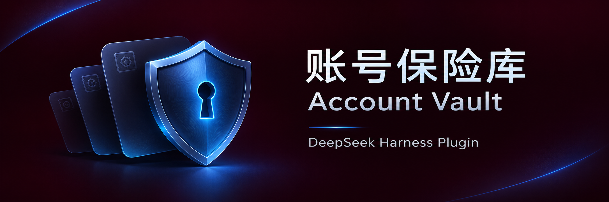

# 账号保险库 / Account Vault



[中文](#中文) · [English](#english) · [截图 / Screenshots](docs/screenshots.md)

## 中文

在 DSH 里保存常用账号和密码。支持搜索、密码生成、多套保险库和加密备份，无云同步。

### 安装

**市场安装（待收录）**：尚未确认进入插件市场，不能视为已上线；收录后可在市场搜索本插件。当前备用方案为 [GitHub Release tgz（v2.2.1）](https://github.com/Veagau/dsh-account-vault/releases/download/v2.2.1/dsh-account-vault.tgz)，不是 npm 包安装。

**Desktop 远程安装**：在应用内插件管理中使用上述完整 URL，或请当前 Desktop 的 DSH agent 调用 `plugin_manager`（工具调用，不是终端命令）：

```json
{"action":"install_bundle","target":"https://github.com/Veagau/dsh-account-vault/releases/download/v2.2.1/dsh-account-vault.tgz"}
```

**Web / CLI**：将 `<profile>` 换成实际运行 Web 的 profile，不要误装进 Desktop：

```sh
dsh plugin --profile <profile> add https://github.com/Veagau/dsh-account-vault/releases/download/v2.2.1/dsh-account-vault.tgz
```

也可请目标 Web 实例中的 agent 调用上述工具。

**本地开发安装**：克隆仓库并保留目录，请 agent 用 `plugin_manager` 安装绝对路径：

```json
{"action":"install_bundle","target":"<account-vault 目录的绝对路径>"}
```

安装影响当前 profile 的所有会话。检查返回的 `application` 和 `warnings`，按提示刷新，再从侧边栏打开「账号保险库」。Windows JSON 路径中的反斜杠写成 `\\`；本地链接安装后不要删除源码目录。需要支持 bundle 的 Harness、Web Crypto 和 localStorage（通常为 HTTPS 或 localhost）。资产若尚不存在，请勿改用来源不明的下载；参见[分发与发布指南](docs/distribution.md)。

### 开始使用

1. 创建主保险库，设置独立的强密码。
2. 解锁后点击「添加账号」，填写名称、密码等信息并保存。
3. 在列表中搜索、编辑或复制；在设置中修改密码、创建附加库。

默认空闲 5 分钟锁定，离开面板也会锁定。

### 备份与恢复

1. 在设置中导出备份：主库导出全部库，附加库只导出自身。
2. 在主库设置或首次恢复界面导入文件。
3. 选择合并或覆盖：合并只添加不存在的库，不合并账号；**覆盖全部会替换所有本地库**。

覆盖前先备份。忘记密码无法找回；旧备份仍需原密码。

### 注意事项

- 账号使用 PBKDF2-SHA-256 和 AES-256-GCM 加密，存于当前浏览器和来源的 localStorage；库数量等元数据可见。
- 清除站点数据、更换浏览器或来源地址可能丢失数据，请保留备份。
- 附加库不是安全沙箱。同源脚本、扩展或有设备访问权限的 agent 可能获取解锁后的明文；锁定不保证擦除内存或剪贴板历史。
- 未经过独立安全审计，请勿作为唯一的密码保管方案。

[详细说明](docs/guide.md) · [反馈问题](https://github.com/Veagau/dsh-account-vault/issues)

### 开发

```sh
npm run check
npm test
```

回归测试不等于完整 UI 测试或安全审计。请勿在 Issue 中上传真实密码或备份。

## English

Keep everyday accounts and passwords in DSH. Includes search, password generation, multiple vaults and encrypted backups. No cloud sync.

### Install

**Marketplace (pending inclusion)**: listing has not been confirmed; this is not a claim of availability. Once listed, search for this plugin in the market. The current fallback is the [GitHub Release tgz (v2.2.1)](https://github.com/Veagau/dsh-account-vault/releases/download/v2.2.1/dsh-account-vault.tgz), not an npm registry installation.

**Desktop remote installation**: use the full URL above in the application's plugin management, or ask the agent in the intended Desktop instance to call `plugin_manager` (a tool, not a shell command):

```json
{"action":"install_bundle","target":"https://github.com/Veagau/dsh-account-vault/releases/download/v2.2.1/dsh-account-vault.tgz"}
```

**Web / CLI**: replace `<profile>` with the profile actually serving your Web instance, not the Desktop profile:

```sh
dsh plugin --profile <profile> add https://github.com/Veagau/dsh-account-vault/releases/download/v2.2.1/dsh-account-vault.tgz
```

Alternatively, ask the agent in the target Web instance to call the tool above.

**Local development installation**: clone and keep the repository, then ask the agent to install its absolute path:

```json
{"action":"install_bundle","target":"<absolute path to account-vault>"}
```

Installation affects all sessions in the current profile. Check `application` and `warnings`, follow refresh instructions, then open **Account Vault** from the sidebar. Escape Windows path backslashes as `\\` in JSON; keep the source directory for local linked installs. Requires a bundle-capable Harness, Web Crypto and localStorage (usually HTTPS or localhost). If the asset is not available yet, do not substitute an untrusted download; see the [distribution guide](docs/distribution.md).

### Get started

1. Create a main vault with a strong, unique password.
2. Unlock it, select **Add account**, fill in the entry and save.
3. Search, edit or copy entries from the list. Use Settings to change passwords or create extra vaults.

The default idle lock is 5 minutes. Leaving the panel also locks it.

### Back up and restore

1. Export from Settings: the main vault exports all vaults; extra vaults export only themselves.
2. Import from main-vault Settings or the initial restore screen.
3. Choose merge or replace. Merge adds missing vaults, not individual entries. **Replace all replaces every local vault.**

Back up before replacing. Forgotten passwords cannot be recovered; older backups still need their original passwords.

### Keep in mind

- Entries use PBKDF2-SHA-256 and AES-256-GCM in localStorage for the current browser and origin. Metadata such as vault count remains visible.
- Clearing site data or changing browser or origin can lose data. Keep backups.
- Extra vaults are not security sandboxes. Same-origin scripts, extensions or agents with device access may capture unlocked data. Locking does not guarantee memory or clipboard erasure.
- No independent security audit has been completed. Do not use this as your only password store.

[Full guide](docs/guide.md) · [Report an issue](https://github.com/Veagau/dsh-account-vault/issues)

### Development

```sh
npm run check
npm test
```

Regression tests are not complete UI coverage or a security audit. Never attach real credentials or backups to issues.

## License

[MIT](LICENSE)
