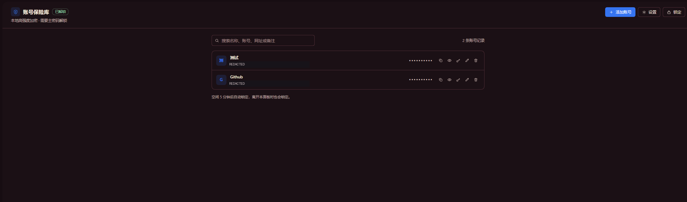
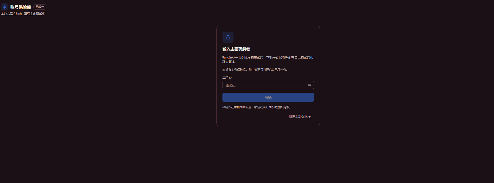
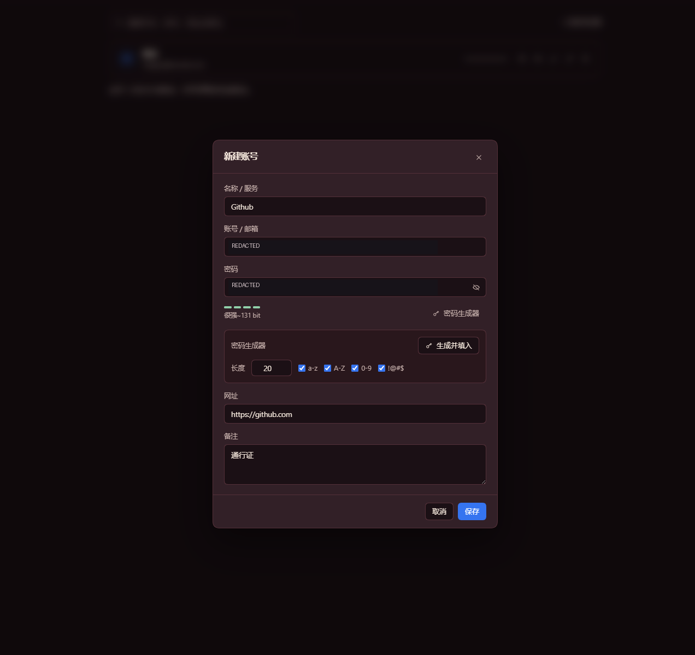
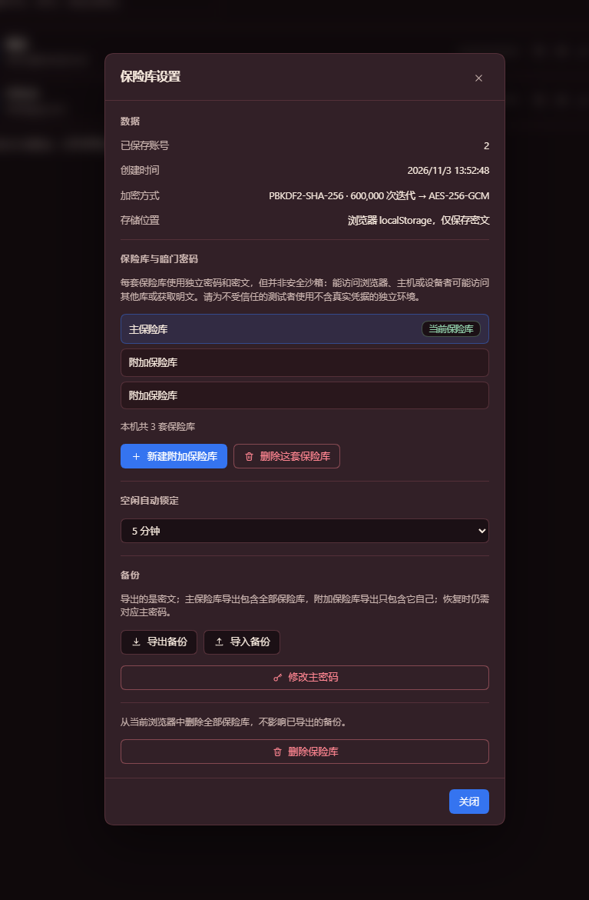
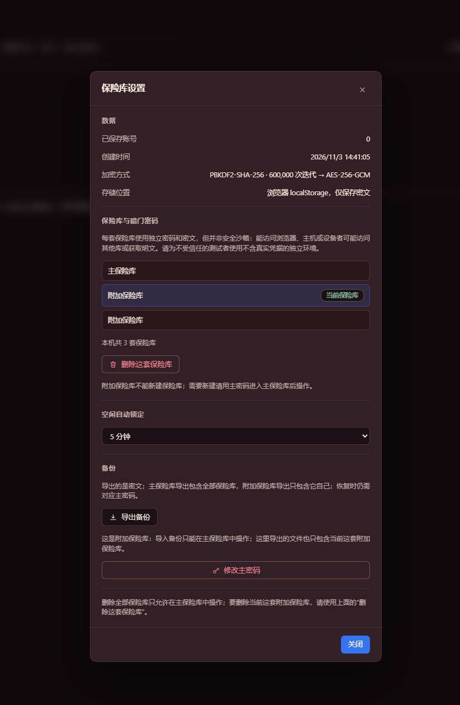

# 界面展示 / Screenshots

用户提供的实机截图，拍摄于 2026-11-04。邮箱和明文密码已遮挡；未修改其他界面内容。截图不构成安全审计或完整功能测试，无法仅据图片确认安装版本。

User-provided screenshots captured on November 4, 2026. Email addresses and the visible password have been redacted; other UI content is unchanged. These images are not a security audit or a complete functional test, and do not establish the installed version.

## 账号列表 / Account list

搜索和账号操作入口；密码保持隐藏。
Search and entry actions, with passwords masked.

## 锁定状态 / Locked vault

通过对应主密码解锁保险库。
Unlock a vault with its corresponding master password.

## 新建账号 / Add an account

账号编辑表单和密码生成器。敏感字段已遮挡。
Entry form and password generator. Sensitive fields are redacted.

## 主保险库设置 / Main vault settings

库管理、自动锁定和加密备份入口。
Vault management, idle locking and encrypted backup controls.

## 附加保险库设置 / Extra vault settings

附加库导出自身数据；导入和新建库仅在主库操作。附加库不是安全沙箱。
An extra vault exports its own data; importing and creating vaults are main-vault actions. Extra vaults are not security sandboxes.

## 验证范围 / Validation scope

源码的静态检查及 6 项运行时回归测试已通过，覆盖格式校验、实际加解密、删除失败与旧数据迁移保护。测试使用合成数据，不代表这些图片中的每个操作均已自动验证；完整 UI、宿主兼容性和独立安全审计未完成。

Source checks and six runtime regression tests passed, covering format validation, actual encryption/decryption, deletion failures and legacy migration protection. Tests use synthetic data and do not automatically verify every action pictured here. Complete UI coverage, host compatibility testing and an independent security audit have not been completed.
